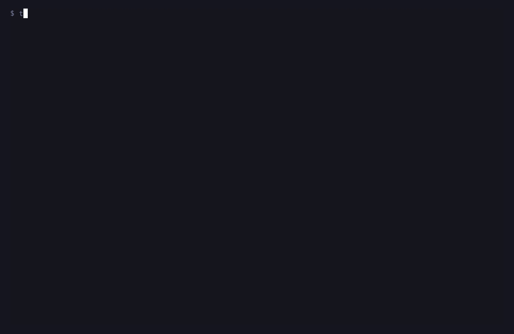

# tobu

Pick a running session or a directory from your [zoxide](https://github.com/ajeetdsouza/zoxide) database and jump
straight into a [zellij](https://zellij.dev) (or tmux) session with your editor and other programs open in it.



```sh
go install github.com/lukasmetzner/tobu@latest
tobu            # interactive, like zi
tobu hccm       # best zoxide match, like z hccm
tobu ./some/dir # an existing directory is used as is
```

With arguments, tobu resolves the directory the way `z` does: a single argument naming an existing directory is used
directly, anything else is passed to `zoxide query` as keywords (excluding the current directory). The result is opened
just like a directory picked interactively.

Without arguments, running sessions are listed first, followed by directories in zoxide score order. A directory whose session is already
running is shown as that session, and the session you are currently in is left out. The list is filtered fuzzily as
you type, like `zi`: space-separated terms must all match, and a term containing an uppercase letter is matched
case-sensitively.

| Key                                  | Action           |
| ------------------------------------ | ---------------- |
| `enter`                              | open session     |
| `up` `ctrl+p` `ctrl+k` `shift+tab`   | previous entry   |
| `down` `ctrl+n` `ctrl+j` `tab`       | next entry       |
| `pgup` `pgdown`                      | page up / down   |
| `esc` `ctrl+c` `ctrl+g` `ctrl+q`     | abort            |

Picking a session attaches to it. Picking a directory creates a session for it with each configured program in its own
tab (tmux: window), the first one focused, or attaches if that session already exists. Inside zellij or tmux the
current client switches to the target session instead of nesting, and the session you leave keeps running in the
background. New zellij sessions get the tab and status bar of zellij's default layout.

## Hotkey

Inside zellij, tobu can run in a floating pane from a keybinding. Zellij handles the key before the focused pane
does, so it works from anywhere, including inside your editor. Add to the `keybinds` block of your zellij
`config.kdl`:

```kdl
shared_except "locked" {
    bind "Alt t" {
        Run "tobu" {
            floating true
            close_on_exit true
            name "tobu"
        }
        SwitchToMode "normal"
    }
}
```

The floating pane closes once you pick a target or abort, so it is gone when you return to the session.

With tmux:

```sh
bind-key t display-popup -E tobu
```

## Configuration

`$XDG_CONFIG_HOME/tobu/config.toml` (usually `~/.config/tobu/config.toml`), or the path in `$TOBU_CONFIG`. If the
file does not exist, tobu creates it on start with the commented defaults from
[`internal/config/default.toml`](internal/config/default.toml). An existing file is never overwritten, and unknown keys
are reported as errors.

Examples:

```toml
[multiplexer]
binary = "tmux"

[session]
name_depth = 2

[[programs]]
binary = "emacs"
args = ["-nw"]

[[programs]]
binary = "lazygit"
```
